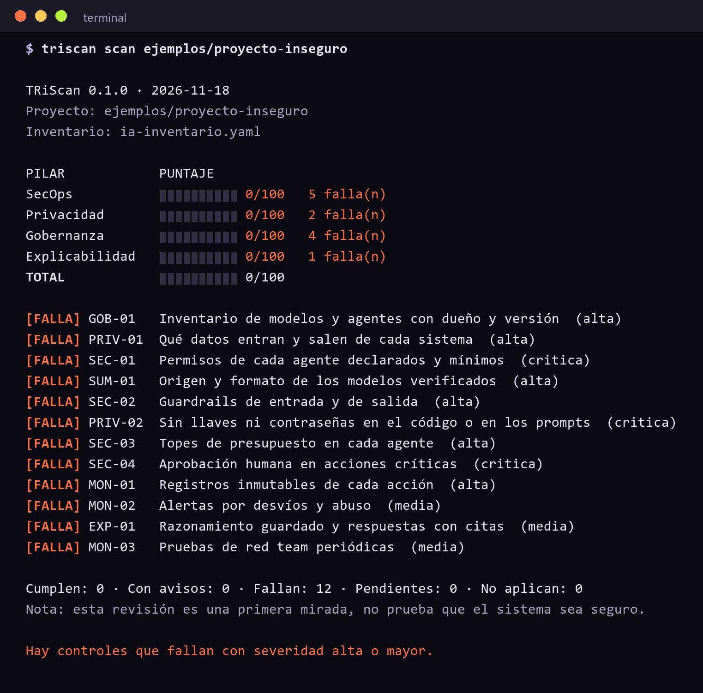
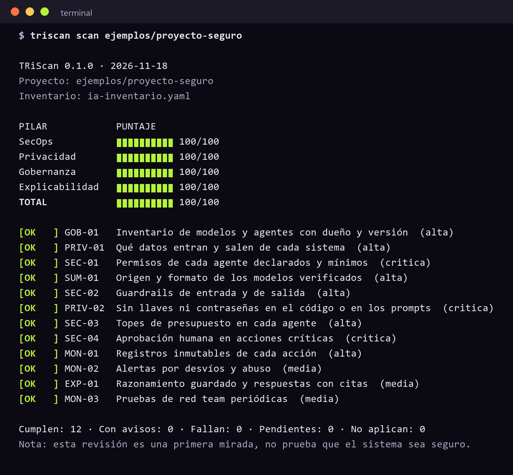
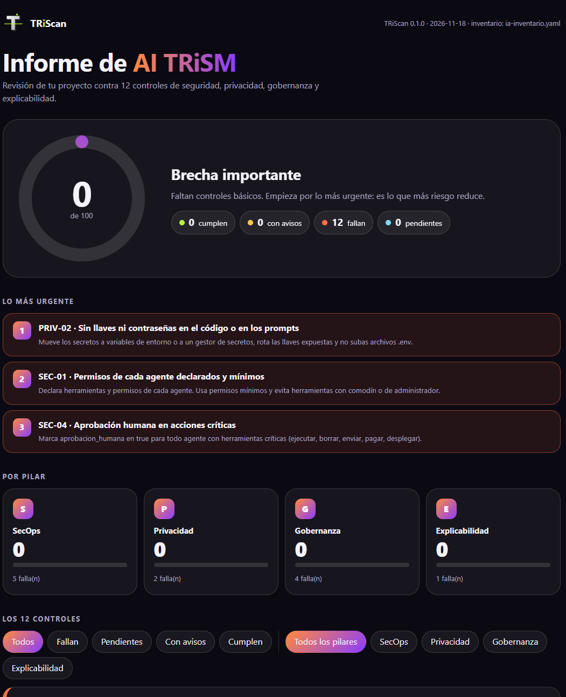
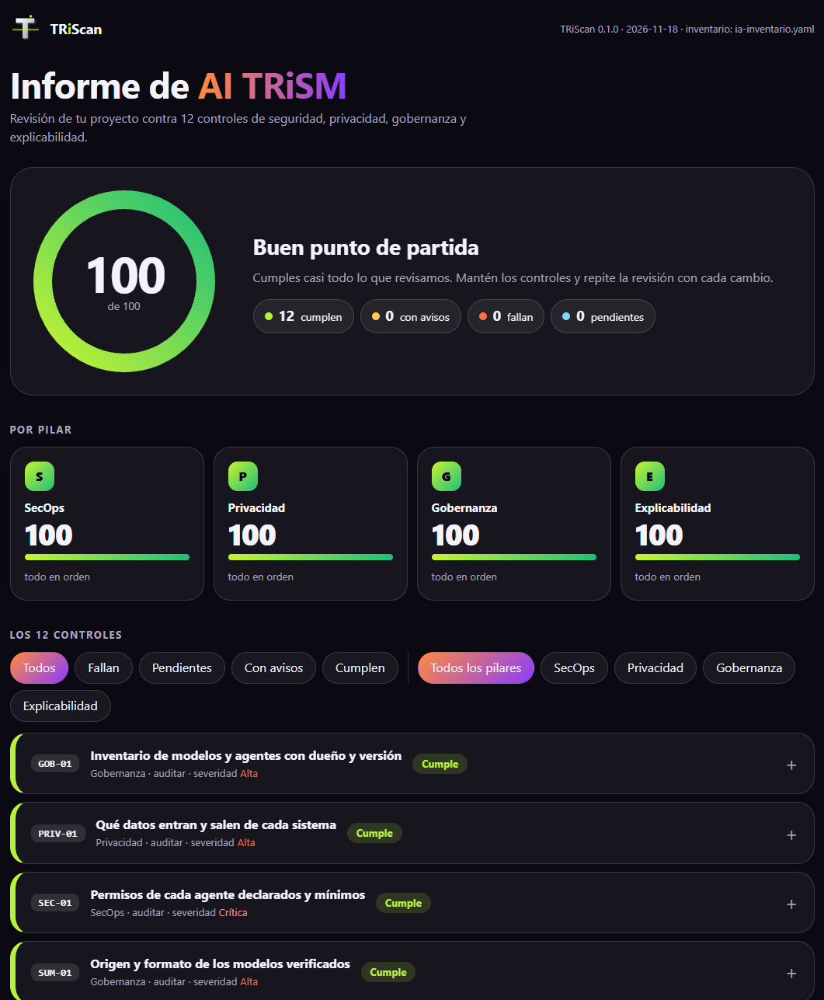

# TRiScan

<p align="center"></p>

**Checklist ejecutable de AI TRiSM.** Revisa un proyecto que usa IA contra 12 controles de seguridad, privacidad, gobernanza y explicabilidad, y te entrega un informe con lo que falta y cómo arreglarlo.

Nació de la charla *"IA sin Control: del boom a la brecha de seguridad"* (BoyaConf 2026). Este repositorio contiene solo la herramienta. Cada control está atado a algo que falló en el caso real que se cuenta en la charla: agentes de IA con permisos de más, sin aprobación humana y con registros que podían alterar (informe técnico independiente de METR, 26 de agosto de 2026).

> ⚠️ **Es una primera mirada, no una garantía.** `triscan` encuentra problemas comunes y deja evidencia para una auditoría. Que salga 100/100 no prueba que tu sistema sea seguro.

## Así se ve

Salida real de `triscan scan` sobre los dos proyectos de ejemplo de este repositorio.

| Antes: `ejemplos/proyecto-inseguro` (0/100) | Después: `ejemplos/proyecto-seguro` (100/100) |
|---|---|
|  |  |

Además de la terminal, `triscan scan` genera un informe visual (`triscan-reporte/reporte.html`) con el puntaje, lo urgente primero y cómo arreglar cada falla.

| Antes: `ejemplos/proyecto-inseguro` (0/100) | Después: `ejemplos/proyecto-seguro` (100/100) |
|---|---|
|  |  |

Puedes abrir dos informes de ejemplo en [`docs/ejemplos/`](docs/ejemplos/): descárgalos y ábrelos en tu navegador.

## Mapa del repositorio

```
triscan/
├─ README.md              ← estás aquí
├─ LICENSE                licencia MIT
├─ CONTRIBUTING.md        cómo contribuir
├─ pyproject.toml         datos del paquete (nombre, versión, comando triscan)
│
├─ src/triscan/          EL CÓDIGO de la herramienta
│   ├─ controles.yaml       los 12 controles (el corazón del proyecto)
│   ├─ reglas.py            cómo se revisa cada control
│   ├─ motor.py             junta todo y calcula puntajes
│   ├─ descubrir.py         detecta dónde usas IA y arma el borrador del inventario
│   ├─ reporte.py           informe visual HTML, Markdown, JSON y SARIF
│   └─ cli.py               comandos: scan, descubrir, init, controles
├─ tests/                 pruebas automáticas (python -m pytest)
├─ ejemplos/              poc-app-soporte (proyecto real de la POC), uno seguro, uno inseguro y una GitHub Action
├─ docs/                  documentación: empezar, inventario, controles, arquitectura, publicar
├─ scripts/               utilidades: probar.bat (demo con doble clic) y revisiones de desarrollo
└─ .github/workflows/     pruebas automáticas en GitHub
```

¿Primera vez? Lee [`docs/empezar.md`](docs/empezar.md). ¿Vas a subirlo a GitHub? Lee [`docs/publicar.md`](docs/publicar.md).

## Por qué existe

- Hay muy buenas herramientas para atacar modelos y probar prompts (garak, PyRIT, promptfoo...). `triscan` **no compite con ellas**: revisa lo que ellas no miran, como el inventario, los permisos de los agentes, la aprobación humana y los registros.
- Funciona **sin enviar tu código a nadie**: corre en tu máquina o en tu proceso de CI.
- El resultado es **repetible**: la misma revisión da el mismo informe, y cada hallazgo apunta a una norma (OWASP, NIST, ISO).
- Está **en español**.

## Cómo se usa en el día a día

```
Día 1 (≈ 15 min)              Cada cambio de código           Cada trimestre / auditoría
triscan descubrir .   ──►    GitHub Action: triscan   ──►   Actualizas el inventario
(borrador automático)         bloquea lo grave                y guardas el informe HTML
completas lo que falta
triscan scan .
```

1. **`triscan descubrir .`** lee tu código, detecta dónde usas IA (OpenAI, Anthropic, LangChain, Hugging Face...) y qué herramientas tienen tus agentes, y escribe un **borrador** de `ia-inventario.yaml`. Tú solo completas lo marcado con `COMPLETA`.
2. **`triscan scan .`** te muestra el informe visual con lo que falta.
3. **En cada cambio de código**, una GitHub Action ejecuta la revisión y bloquea lo grave.

¿Quieres verlo funcionando en un proyecto real (no en uno "perfecto" o "terrible")? Ejecuta la **POC del día 1**: `scripts\poc-dia1.bat` (Windows) o `python scripts/poc_dia1.py`. Está explicada en [`docs/poc-dia-1.md`](docs/poc-dia-1.md): un agente de soporte pasa de 1/12 a 12/12 en 4 pasos.

## Instalación

Requiere Python 3.9 o superior.

```bash
pip install git+https://github.com/Jpsuarez54/triscan
```

## Uso rápido

```bash
triscan init                 # crea un ia-inventario.yaml para que lo completes
triscan scan .               # resumen en la terminal + informe visual que se abre en tu navegador
triscan scan . --sin-abrir   # igual, pero sin abrir el navegador
triscan scan . -f terminal   # solo terminal, sin archivos
triscan controles            # lista los 12 controles
```

El **informe visual** (`triscan-reporte/reporte.html`) es un solo archivo, sin conexión a internet: puntaje animado, lo más urgente, puntaje por pilar y los 12 controles con filtros, cómo arreglarlos y sus referencias. Se puede imprimir o guardar como PDF. En CI (variable `CI`) nunca abre el navegador.

Prueba con los ejemplos que trae el repositorio:

```bash
triscan scan ejemplos/proyecto-inseguro     # falla los 12 controles
triscan scan ejemplos/proyecto-seguro       # cumple los 12
```

Ejemplo de salida (ilustrativo):

```
PILAR            PUNTAJE
SecOps           ###....... 30/100   3 falla(n)
Privacidad       ######.... 60/100
Gobernanza       ####...... 45/100   2 falla(n)
Explicabilidad   #######... 70/100

[FALLA ] SEC-04   Aprobación humana en acciones críticas  (critica)
           - El agente 'soporte' tiene herramientas críticas (ejecutar_shell) sin aprobación humana.
           Arreglo: Marca aprobacion_humana en true para todo agente con herramientas críticas.
```

## Cómo funciona

`triscan` combina dos fuentes:

1. **Lo que lee solo** en tu carpeta: cargas inseguras de modelos (`pickle`, `trust_remote_code=True`), llaves y contraseñas fijas, archivos `.env`, librerías de guardrails y herramientas de red team.
2. **Lo que declaras** en `ia-inventario.yaml`: dueños, datos, permisos, topes, aprobación humana, registros, alertas, razonamiento y citas.

Cada control termina en uno de estos estados: `cumple`, `aviso` (cumple, pero revísalo), `falla`, `pendiente` (falta información para revisarlo) o `no aplica`.

### Los 12 controles

| ID | Pilar | Fase | Severidad | Qué revisa |
|---|---|---|---|---|
| GOB-01 | Gobernanza | Auditar | alta | Inventario de modelos y agentes con dueño y versión |
| PRIV-01 | Privacidad | Auditar | alta | Clase de datos que usa cada sistema |
| SEC-01 | SecOps | Auditar | crítica | Permisos de cada agente declarados y mínimos |
| SUM-01 | Gobernanza | Auditar | alta | Origen y formato de modelos (pickle, revisión fija, código remoto) |
| SEC-02 | SecOps | Asegurar | alta | Guardrails de entrada y de salida |
| PRIV-02 | Privacidad | Asegurar | crítica | Sin llaves, tokens ni contraseñas en el código |
| SEC-03 | SecOps | Asegurar | alta | Topes de presupuesto por agente |
| SEC-04 | SecOps | Asegurar | crítica | Aprobación humana en acciones críticas |
| MON-01 | Gobernanza | Monitorear | alta | Registros inmutables de cada acción |
| MON-02 | Gobernanza | Monitorear | media | Alertas por desvíos y abuso |
| EXP-01 | Explicabilidad | Monitorear | media | Razonamiento guardado y citas en RAG |
| MON-03 | SecOps | Monitorear | media | Pruebas de red team periódicas |

El detalle de cada uno (por qué importa, cómo arreglarlo y sus referencias) está en [`src/triscan/controles.yaml`](src/triscan/controles.yaml). Las referencias a **OWASP Top 10 para aplicaciones LLM (2025)** son por identificador (LLM01...LLM10). Las de **NIST AI RMF** son por función (GOVERN, MAP, MEASURE, MANAGE) y la de **ISO/IEC 42001** es al Anexo A en general: son una guía, no un mapeo formal.

## El inventario (`ia-inventario.yaml`)

```yaml
version: 1
modelos:
  - id: modelo-soporte
    dueno: equipo-ml@empresa.com
    version: "1.2.0"
    origen: huggingface.co/org/modelo-soporte
    revision: "a1b2c3d4"          # fija el modelo exacto
    formato: safetensors
    datos: [interno]               # publico | interno | personal | sensible
agentes:
  - id: agente-soporte
    dueno: equipo-soporte@empresa.com
    modelo: modelo-soporte
    datos: [personal]
    herramientas: [buscar_base_conocimiento, enviar_correo]
    permisos: minimo
    aprobacion_humana: true        # obligatorio con herramientas críticas
    presupuesto: {max_tokens: 20000, max_pasos: 15}
    guardrails: {entrada: true, salida: true}
    registros: {destino: s3://registros/agente, inmutable: true, evidencia: https://wiki/registros}
    alertas: true
    registra_razonamiento: true
```

Hay una plantilla completa y comentada en [`src/triscan/plantilla_inventario.yaml`](src/triscan/plantilla_inventario.yaml) (`triscan init` la copia a tu proyecto).

## En tu proceso de CI (GitHub Actions)

`triscan` devuelve código de salida `1` si algún control falla con la severidad indicada en `--falla-en` (por defecto, `alta`). Así puede bloquear un cambio de código.

Un ejemplo listo para copiar está en [`ejemplos/github-action/triscan.yml`](ejemplos/github-action/triscan.yml). Sube el informe en formato **SARIF** para que los hallazgos aparezcan en la pestaña *Security* del repositorio.

## Formatos de salida

`-f terminal` (por defecto) · `-f md` · `-f html` · `-f json` · `-f sarif`. Se pueden combinar: `triscan scan . -f html -f sarif -o informe`.

## Límites honestos

- Revisa **patrones comunes**, no entiende tu aplicación. Puede tener falsos positivos y falsos negativos. Se probó en tres repositorios públicos reales; el detalle y los límites están en [`docs/pruebas-en-proyectos-reales.md`](docs/pruebas-en-proyectos-reales.md).
- `descubrir` solo detecta Python y JavaScript/TypeScript.
- Lo que declaras en el inventario **no se verifica** contra la realidad: pide evidencia (enlaces, documentos) y revísala.
- La revisión de código mira texto con expresiones regulares y no analiza el flujo del programa.
- No reemplaza una auditoría, una prueba de penetración ni a un equipo de seguridad.

## Contribuir

Lee [`CONTRIBUTING.md`](CONTRIBUTING.md). Las ideas más útiles: nuevas reglas con ejemplos de falso positivo y falso negativo, soporte para más lenguajes, y traducciones.

## Hoja de ruta

- [x] `triscan descubrir`: borrador automático del inventario (detección por patrones en Python y JS/TS)
- [ ] `--base`: ignorar los problemas que ya existían y fallar solo por los nuevos
- [ ] `triscan survey`: cuestionario guiado para quien no lee código
- [ ] Simulador interactivo del caso Hugging Face (activa controles y mira cómo se frena el ataque)
- [ ] Más reglas para JavaScript/TypeScript
- [ ] Plantillas de políticas en español

## Licencia

MIT. Ver [`LICENSE`](LICENSE).

